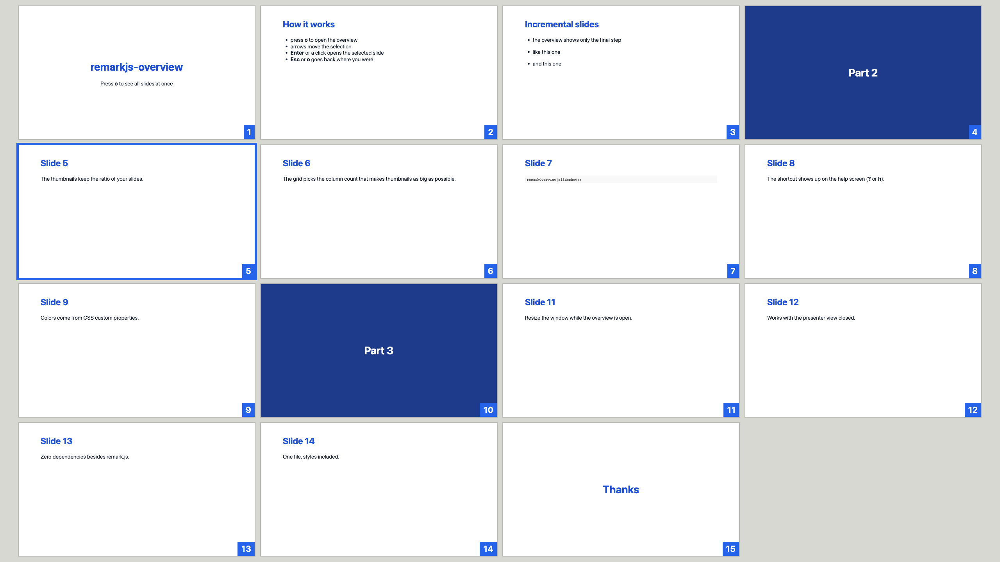

# remarkjs-overview 🗂️

<!-- prettier-ignore-start -->
[](https://github.com/piecioshka/remarkjs-overview/actions/workflows/ci.yml)
[](https://piecioshka.mit-license.org)
<!-- prettier-ignore-end -->

> See all your [remark.js](https://github.com/gnab/remark) slides at once. Press `o` and the whole deck zooms out into a grid that fits the screen.

[](https://piecioshka.github.io/remarkjs-overview/demo/)

**Demo:** <https://piecioshka.github.io/remarkjs-overview/demo/> (press `o`)

## Features ✨

- 🔍 Maximum zoom-out _(the grid picks the column count that gives the biggest thumbnails, no scrolling)_
- ⌨️ Keyboard first _(`o` toggles, arrows move the selection, `Enter` opens it, `Esc` takes you back)_
- 🖱️ Click any thumbnail to jump to that slide
- 🪜 Incremental slides collapse into their final step _(`--` separators)_
- ❓ The shortcut shows up on remark's help screen _(`?` or `h`)_
- 📐 Keeps your slide ratio _(4:3, 16:9 or anything else)_
- 🎨 Themeable with CSS custom properties
- 📦 One file, styles included, zero dependencies besides remark.js

## Installation 📦

### 1. Get the file

Download [`remark-overview.js`](remark-overview.js) next to your slides, for example to `vendor/`:

```bash
curl -fsSL -o vendor/remark-overview.js \
  https://raw.githubusercontent.com/piecioshka/remarkjs-overview/v0.1.0/remark-overview.js
```

Or load it straight from jsDelivr:

```html
<script src="https://cdn.jsdelivr.net/gh/piecioshka/remarkjs-overview@v0.1.0/remark-overview.js"></script>
```

### 2. Load it after remark

```html
<script src="vendor/remark.min.js"></script>
<script src="vendor/remark-overview.js"></script>
<script>
  const slideshow = remark.create({ sourceUrl: "slides.md" });
  remarkOverview(slideshow);
</script>
```

That's it. Press `o` to open the overview. The new shortcut is also listed on the help screen (`?`).

> [!NOTE]
> Call `remarkOverview()` once, right after `remark.create()`. The plugin needs the instance to read the slides and to navigate.

## Keyboard shortcuts ⌨️

| Key             | Action                                           |
| --------------- | ------------------------------------------------ |
| `o`             | open or close the overview                       |
| `←` `→` `↑` `↓` | move the selection                               |
| `Enter`         | open the selected slide                          |
| click           | open the clicked slide                           |
| `Esc`           | close the overview and stay on the current slide |

While the overview is open, remark's own shortcuts are paused, so the slideshow behind it doesn't move.

## Options ⚙️

```js
remarkOverview(slideshow, {
  key: "o", // key that toggles the overview
  gap: 8, // space between thumbnails, in pixels
  hideIncrementalSteps: true, // show only the final step of `--` slides
  helpText: "Toggle slides overview", // label on the help screen
});
```

The function returns `{ open, close, toggle, isOpen }`, so you can also control the overview from your own code.

## Theming 🎨

Set these custom properties anywhere in your CSS:

```css
:root {
  --remark-overview-accent: #3b82f6; /* selection, hover, slide number badge */
  --remark-overview-on-accent: #ffffff; /* text on the badge */
  --remark-overview-line: rgba(127, 127, 127, 0.35); /* thumbnail border */
}
```

## Browser support 🌐

Any browser with [constructable stylesheets](https://caniuse.com/mdn-api_document_adoptedstylesheets): Chrome 73+, Edge 79+, Firefox 101+, Safari 16.4+.

## Contributing 🤝

See [CONTRIBUTING.md](CONTRIBUTING.md).

## License 📄

[The MIT License](https://piecioshka.mit-license.org) @ 2026
